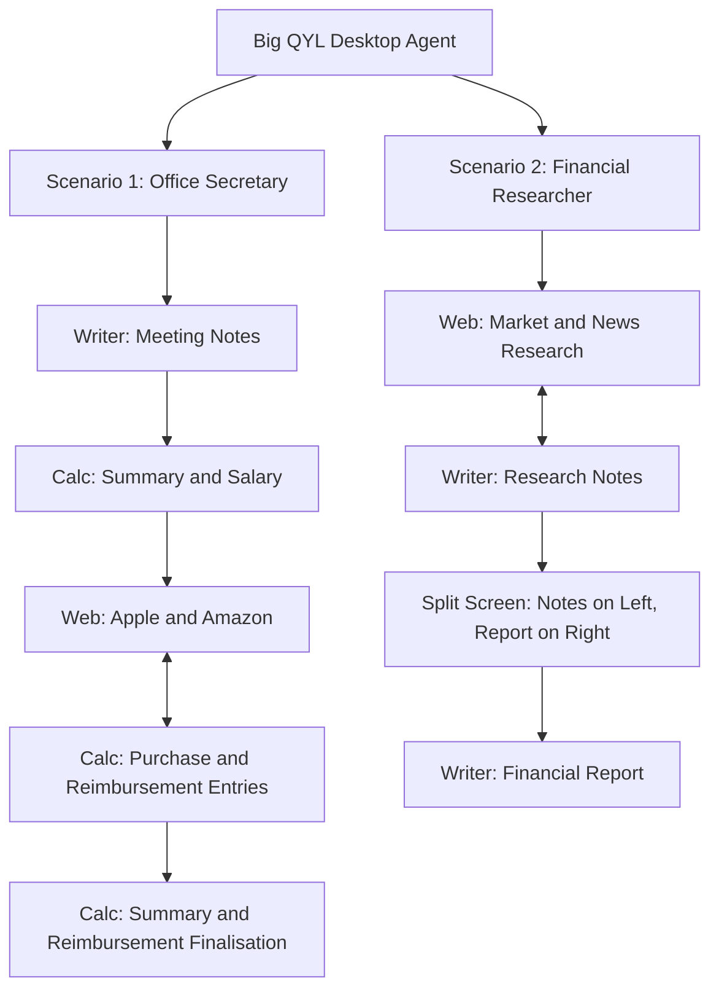

# Big QYL

**Desktop Workflow Automation | NTU X-ST Engineering Hackathon**

This is a Python-based desktop automation project that demonstrates two multi-application workflows inside a **Windows virtual machine hosted on Proxmox**. A combined agent run coordinates mouse and keyboard interactions across **OpenOffice Writer**, **OpenOffice Calc**, and a web browser to complete office administration and financial research tasks.

The project is demonstrated through a single launch action in a prepared VM. **Sysmon** and **Process Monitor** are used to observe and document activity generated during execution.

> **Project status:** Both scenarios are included in the submission. Final repository filenames, code layout, and evidence paths will be added when the team consolidates its source code.

## Project objectives

- Demonstrate end-to-end desktop workflows that cross application boundaries.
- Coordinate document editing, spreadsheet updates, and web browsing in a single run.
- Use context-specific workflows rather than isolated clicks or keystrokes.
- Record and analyse the resulting application and system activity with Sysmon and Process Monitor.

## Workflow overview

Our design is illustrated as a **behaviour-tree-inspired workflow** with two scenarios. The diagram describes the order of tasks and the transitions between applications; it does not imply that a dedicated behaviour-tree library is used.



### Scenario 1 — Office Secretary

This scenario follows an administrative workflow involving meeting documentation, employee salary updates, product browsing, and spreadsheet reconciliation.

1. **Write meeting notes:** Open OpenOffice Writer, prepare meeting notes, and save the document.
2. **Update salary information:** Open the existing OpenOffice Calc workbook, update the employee salary on the **Salary** sheet, and reflect the change in **Summary**.
3. **Browse product information:** Visit the Apple and Amazon web pages while working with the spreadsheet's purchase/reimbursement entries.
4. **Update reimbursements:** Enter the relevant quantities, prices, and approval statuses on the **Reimbursement** sheet.
5. **Finalise the spreadsheet:** Return to **Summary**, update the reimbursement information, calculate net earnings using spreadsheet references, and save the workbook.

**End point:** The scenario finishes with the spreadsheet. **Sending email is not part of the final workflow.**

### Scenario 2 — Financial Researcher

This scenario models a research-to-report workflow in which the agent collects market context, records notes, and drafts a structured report using a side-by-side document layout.

1. **Browse research sources:** Navigate between [CoinMarketCap](https://coinmarketcap.com/) and [AP News](https://apnews.com/).
2. **Prepare research notes:** Use OpenOffice Writer to record cryptocurrency-market observations, news context, and a short conclusion while the research phase progresses.
3. **Set up split screen:** Keep the completed **Research Notes** document on the **left**, and open a second Writer document for the **Financial Report** on the **right**.
4. **Draft the financial report:** Write the report using material aligned with the selected research topic, then save the document.
5. **Close the documents:** Close both Writer windows after saving.

The report text is based on **predefined, topic-matched content**. The current automation does **not** independently extract live website content or dynamically generate a report from the text inside Writer; the research notes and report are coordinated by their selected topic.

## Implementation approach

The combined workflow uses Python to orchestrate desktop actions on a preconfigured Windows VM.

| Component | Purpose |
| --- | --- |
| **Python** | Workflow control and coordination |
| **PyAutoGUI** | Mouse movement, clicking, typing, keyboard shortcuts, and application interaction |
| **Windows API (`ctypes`)** | Window identification and positioning where required |
| **OpenOffice Writer** | Meeting notes, research notes, and financial report |
| **OpenOffice Calc** | Salary, reimbursement, and financial summary updates |
| **Web browser** | Product, cryptocurrency-market, and news browsing |
| **Proxmox-hosted Windows VM** | Execution environment |
| **Sysmon** | System event logging for analysis |
| **Process Monitor** | Observation of process, file, and related system activity |

### Interaction design

- The agent follows a defined sequence of tasks while switching among documents, spreadsheet sheets, and web pages.
- Writer automation includes controlled typing intervals and editing interactions.
- Calc automation uses cell entry and formulas, including updating dependent financial figures.
- The financial-report stage positions two Writer windows side by side so research notes remain visible while the report is written.
- Desktop window size, display resolution, application focus, and zoom settings can affect coordinate-based interactions; the demo VM should retain the configuration used for testing.

## Running the demonstration

**Execution model:** One-click launch of the **combined agent** in the team's prepared Proxmox Windows VM.

1. Start the prepared Windows VM and ensure the required applications and monitoring tools are available.
2. Launch the combined agent using the team's **one-click entry point**: **`[TO BE ADDED: launcher or script name]`**.
3. Observe the two scenarios running in sequence.
4. Review the resulting documents, workbook, and Sysmon/Process Monitor records.

> **Setup note:** The final entry-point filename and detailed environment provisioning steps have not yet been confirmed. The one-click workflow assumes the VM has already been configured. This README will be updated with exact paths and reproducible setup instructions after integration.

## Repository structure

The final folder names and filenames are **to be determined**. Replace this placeholder with the actual GitHub tree after combining the scripts:

```text
[repository-root]/
├── README.md
├── [TO BE ADDED: combined agent entry point]
├── [TO BE ADDED: scenario modules / supporting code]
├── [TO BE ADDED: required input files, if distributable]
└── [TO BE ADDED: demo images, logs, or documentation]
```

## Outputs and evidence

The expected demonstration outputs include:

- **Scenario 1:** A saved Writer meeting-notes document and an updated Calc workbook.
- **Scenario 2:** Saved Writer research notes and a saved financial report.
- **Monitoring evidence:** Screenshots and/or exported evidence from Sysmon and Process Monitor showing activity during the run.
- **Demo video:** A recording or walkthrough of the combined workflow.

**Screenshots and links** will be added here after capture:

| Evidence | Status |
| --- | --- |
| Scenario 1 — Writer and Calc | `[TO BE ADDED]` |
| Scenario 1 — Web and reimbursement workflow | `[TO BE ADDED]` |
| Scenario 2 — Research notes and split-screen report | `[TO BE ADDED]` |
| Sysmon event logs | `[TO BE ADDED]` |
| Process Monitor capture | `[TO BE ADDED]` |
| 15-minute demo video / walkthrough | `[TO BE ADDED]` |
| Implementation report (PDF) | `[TO BE ADDED]` |

## Known limitations

- **Coordinate sensitivity:** GUI coordinates may shift if the VM resolution, Windows display scaling, Calc zoom, or application window position changes.
- **Application focus:** Keyboard shortcuts require the expected window or dialog to be active.
- **Prepared environment:** The one-click run depends on a configured Windows VM and the required documents/applications.
- **Research content:** The financial report uses topic-matched prepared content rather than live extraction and real-time synthesis from the websites.

## Submission checklist

- [ ] Upload the complete combined source code to GitHub.
- [ ] Replace all `[TO BE ADDED]` placeholders with final filenames, instructions, screenshots, and links.
- [ ] Submit the GitHub repository URL to Devpost.
- [ ] Submit the implementation documentation as a PDF, including architecture, agent functions, screenshots, and system/event-log evidence.
- [ ] Submit a clear demo video or walkthrough covering the live run.

## Team

**Big QYL**

Team member names and roles: 
1. Khoo Ding Feng - Web Browsing
2. Tan Wei Hang - Orchestrator
3. Tee Wei Loon - OpenOffice Writer and Calc

---

*Prepared for the NTU X-ST Engineering Hackathon. The workflows and tooling above reflect the team's stated implementation scope; unconfirmed submission details are intentionally left as placeholders.*
