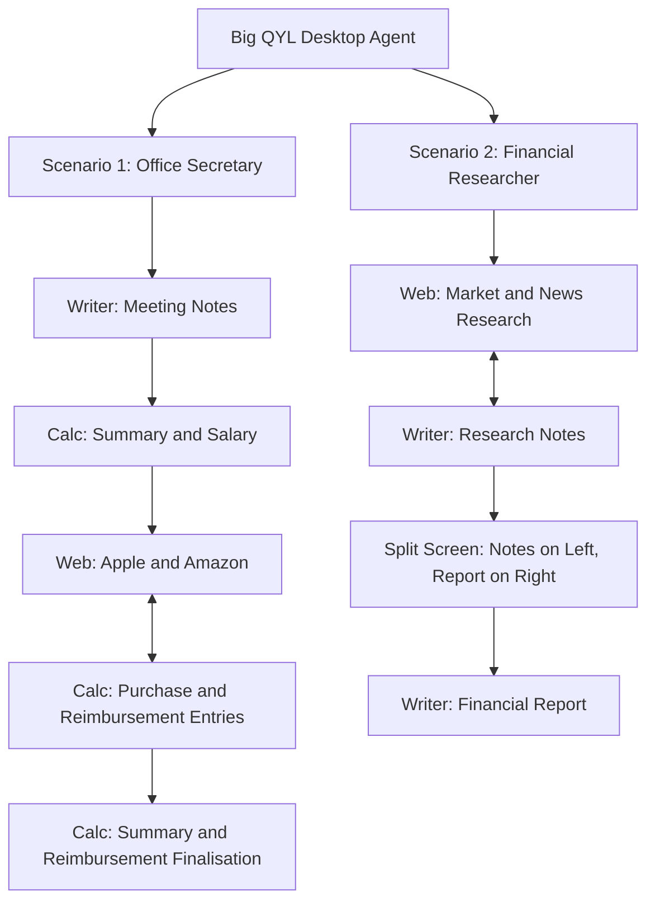

# Big QYL

**Desktop Workflow Automation | NTU X-ST Engineering Hackathon**

This is a Python-based desktop automation project that demonstrates two multi-application workflows inside a **Windows virtual machine hosted on Proxmox**. A combined agent run coordinates mouse and keyboard interactions across **OpenOffice Writer**, **OpenOffice Calc**, and a web browser to complete office administration and financial research tasks.

The project is demonstrated through a single launch action in a prepared VM. **Sysmon** and **Process Monitor** are used to observe and document activity generated during execution.

> **Project status:** Both scenarios are implemented and integrated into a single combined agent (`orchestrator.py`). The source code has been consolidated into this repository; final filenames and code layout are documented under **Repository structure** below. Monitoring evidence has been captured and is included in the submission documentation.

## Project objectives

- Demonstrate end-to-end desktop workflows that cross application boundaries.
- Coordinate document editing, spreadsheet updates, and web browsing in a single run.
- Use context-specific workflows rather than isolated clicks or keystrokes.
- Record and analyse the resulting application and system activity with Sysmon and Process Monitor.

## Workflow overview

Our design is illustrated as a **behaviour-tree-inspired workflow** with two scenarios. The diagram describes the order of tasks and the transitions between applications; it does not imply that a dedicated behaviour-tree library is used.



### Scenario 1 — Office Secretary

This scenario follows an administrative workflow involving meeting documentation, employee salary updates, product browsing, and spreadsheet reconciliation.

1. **Write meeting notes:** Open OpenOffice Writer, prepare meeting notes, and save the document.
2. **Update salary information:** Open the existing OpenOffice Calc workbook, update the employee salary on the **Salary** sheet, and reflect the change in **Summary**.
3. **Browse product information:** Visit the Apple and Amazon web pages while working with the spreadsheet's purchase/reimbursement entries.
4. **Update reimbursements:** Enter the relevant quantities, prices, and approval statuses on the **Reimbursement** sheet.
5. **Finalise the spreadsheet:** Return to **Summary**, update the reimbursement information, calculate net earnings using spreadsheet references, and save the workbook.

**End point:** The scenario finishes with the spreadsheet. 

### Scenario 2 — Financial Researcher

This scenario models a research-to-report workflow in which the agent collects market context, records notes, and drafts a structured report using a side-by-side document layout.

1. **Browse research sources:** Navigate between [CoinMarketCap](https://coinmarketcap.com/) and [AP News](https://apnews.com/).
2. **Prepare research notes:** Use OpenOffice Writer to record cryptocurrency-market observations, news context, and a short conclusion while the research phase progresses.
3. **Set up split screen:** Keep the completed **Research Notes** document on the **left**, and open a second Writer document for the **Financial Report** on the **right**.
4. **Draft the financial report:** Write the report using material aligned with the selected research topic, then save the document.
5. **Close the documents:** Close both Writer windows after saving.

The report text is based on **predefined, topic-matched content**. The current automation does **not** independently extract live website content or dynamically generate a report from the text inside Writer; the research notes and report are coordinated by their selected topic.

## Implementation approach

The combined workflow uses Python to orchestrate desktop actions on a preconfigured Windows VM.

| Component | Purpose |
| --- | --- |
| **Python** | Workflow control and coordination |
| **PyAutoGUI** | Mouse movement, clicking, typing, keyboard shortcuts, and application interaction |
| **Windows API (`ctypes`)** | Window identification and positioning where required |
| **OpenOffice Writer** | Meeting notes, research notes, and financial report |
| **OpenOffice Calc** | Salary, reimbursement, and financial summary updates |
| **Web browser** | Product, cryptocurrency-market, and news browsing |
| **Proxmox-hosted Windows VM** | Execution environment |
| **Sysmon** | System event logging for analysis |
| **Process Monitor** | Observation of process, file, and related system activity |

### Orchestration and process design

The two scenarios and all individual modules are coordinated by a single orchestrator (`orchestrator.py`), which is the only program launched at run time:

- **Single process:** The orchestrator *imports* each module (web browsing, Writer, Calc, research notes, financial report) as Python functions rather than launching them as separate scripts or subprocesses, so the whole run executes inside one `pythonw.exe` process with no console window and no child interpreters.
- **In-memory handoff:** Data shared between stages (for example, the selected research topic) is passed in memory, so no intermediate/session files are written to disk.
- **Behaviour-tree-inspired control:** Stages run as an ordered sequence; each stage is wrapped in error handling so a single failure is logged and the workflow continues.
- **Adaptive timing:** The orchestrator targets a run length of roughly 15 minutes by adjusting only the pauses *between* stages, never speeding up or cutting a stage in progress.
- **Emergency stop:** A background watcher thread terminates the run immediately on a hotkey (Shift + Esc) if manual intervention is needed.

### Interaction design

- The agent follows a defined sequence of tasks while switching among documents, spreadsheet sheets, and web pages.
- Writer automation includes controlled typing intervals and editing interactions, including variable per-character delays and occasional typo-and-correction behaviour.
- Web automation uses non-linear timing, curved (Bézier) mouse movement, and scrolling that mimic human browsing.
- Calc automation uses cell entry and formulas, including updating dependent financial figures.
- The financial-report stage positions two Writer windows side by side so research notes remain visible while the report is written.
- Desktop window size, display resolution, application focus, and zoom settings can affect coordinate-based interactions; the demo VM should retain the configuration used for testing.

## Running the demonstration

**Execution model:** One-click launch of the **combined agent** in the team's prepared Proxmox Windows VM.

1. Start the prepared Windows VM and ensure the required applications and monitoring tools are available.
2. Launch the combined agent using the team's **one-click entry point**: **`orchestrator.py`**. In the demo VM this is registered as a **Windows Scheduled Task**, so a single trigger starts it via `pythonw.exe` (no console window). Launching through the shell / Task Scheduler keeps the process telemetry clean for analysis.
3. Observe the two scenarios running in sequence.
4. Review the resulting documents, workbook, and Sysmon/Process Monitor records.

> **Setup note:** The one-click workflow assumes the VM has already been configured with OpenOffice, a web browser, the input workbook, and the monitoring tools. At run time the module files are placed in a single working folder alongside `orchestrator.py` (in this repository they are grouped into `DF/` and `WL/` subfolders for authorship clarity — see **Repository structure**). The VM must retain the display resolution and window configuration used during testing, as some interactions are coordinate-based.

## Repository structure

```text
ST-Engineering-Hackathon/
├── README.md
├── .gitignore
├── orchestrator.py                     # combined agent entry point (runs both scenarios)
├── DF/
│   └── web_tasks.py                    # web browsing module (Khoo Ding Feng)
└── WL/                                 # OpenOffice Writer & Calc modules (Tee Wei Loon)
    ├── office_worker.py                # meeting notes (Scenario 1)
    ├── spreadsheet_part1.py            # salary update
    ├── spreadsheet_part2.py            # Apple laptop reimbursement
    ├── spreadsheet_part3.py            # external SSD reimbursement
    ├── spreadsheet_part4.py            # summary & net earnings
    ├── research_notes_part1.py         # research notes — part 1 (Scenario 2)
    ├── research_notes_part2.py         # research notes — part 2 (Scenario 2)
    ├── financial_report.py             # split-screen financial report (Scenario 2)
    └── profit and loss statement.ods   # input workbook for Calc
```

> **Note on layout vs. runtime:** The `DF/` and `WL/` folders preserve authorship. For a live run, the `.py` modules are co-located in a single folder with `orchestrator.py` so the orchestrator can import them directly.

## Outputs and evidence

The demonstration produces the following outputs:

- **Scenario 1:** A saved Writer meeting-notes document (`Meeting Notes`) and an updated Calc workbook (`Profit and Loss Statement`).
- **Scenario 2:** Saved Writer research notes (`Research Notes`) and a saved financial report (`Financial Report`).
- **Monitoring evidence:** Screenshots and exported evidence from Sysmon and Process Monitor / Process Explorer showing activity during the run.
- **Demo video:** A screen recording of the combined workflow.

Key verification results captured during a full run:

- Both scenarios completed in a single run (**0 stages failed**), in approximately **16 minutes**.
- Applications (Chrome, OpenOffice Writer) launched with parent process **`explorer.exe`** — a human-like launch path.
- The agent ran as a **single `pythonw.exe`** process (no console, no child interpreters), launched by the Windows Task Scheduler service.
- **No** `cmd.exe` / `conhost.exe` / `powershell.exe` were spawned, and **no** debug or session files were left on disk.
- Resource use: agent ≈ **0.5% CPU / ≈ 11 MB RAM**, with the real applications (e.g. Chrome ≈ 269 MB) accounting for nearly all usage.

**Screenshots and links** are tracked below:

| Evidence | Status |
| --- | --- |
| Scenario 1 — Writer and Calc | Captured — in submission documentation |
| Scenario 1 — Web and reimbursement workflow | Captured — in submission documentation |
| Scenario 2 — Research notes and split-screen report | Captured — in submission documentation |
| Sysmon event logs | Captured — in submission documentation |
| Process Monitor / Process Explorer capture | Captured — in submission documentation |
| 15-minute demo video / walkthrough | Recorded — to be linked |
| Implementation report (PDF) | Drafted — in submission documentation |

## Known limitations

- **Coordinate sensitivity:** GUI coordinates may shift if the VM resolution, Windows display scaling, Calc zoom, or application window position changes.
- **Application focus:** Keyboard shortcuts require the expected window or dialog to be active.
- **Prepared environment:** The one-click run depends on a configured Windows VM and the required documents/applications.
- **Research content:** The financial report uses topic-matched prepared content rather than live extraction and real-time synthesis from the websites.

## Submission checklist

- [ ] Upload the complete combined source code to GitHub.
- [ ] Replace any remaining placeholders with final links (demo video, Devpost).
- [ ] Submit the GitHub repository URL to Devpost.
- [ ] Submit the implementation documentation as a PDF, including architecture, agent functions, screenshots, and system/event-log evidence.
- [ ] Submit a clear demo video or walkthrough covering the live run.

## Team

**Big QYL**

Team member names and roles: 
1. Khoo Ding Feng - Web Browsing
2. Tan Wei Hang - Orchestrator
3. Tee Wei Loon - OpenOffice Writer and Calc

---

*Prepared for the NTU X-ST Engineering Hackathon. The workflows and tooling above reflect the team's implementation; any remaining placeholders mark external artefacts (e.g. the final demo-video link) to be added before submission.*
